# Congestion Control × RLC Buffer-Size Sweep — Scout 5G Testbed

Two campaigns, 2026-07-24, 2 UEs, downlink, picoquic userspace CC.
- **[Run 1](#run-1)** — buffers 100 KB–6 MB, latency = RLC queuing proxy. Result: flat
  (buffers never bound). Led to Run 2.
- **[Run 2](#run-2)** — small **binding** buffers 5–400 KB, latency = **real QUIC RTT**
  from the endpoint (`quic_probe.py`). Result: clear bufferbloat knee + CC differences.

Full methodology, scripts, and gotchas: [`EXPERIMENT_LOG.md`](EXPERIMENT_LOG.md).

---

## Run 1

**Run 1** (RLC-latency-as-RTT proxy). ~76 min, buffers 100 KB–6 MB.

## Setup

- **RAN:** srsRAN gNB (jbpf-instrumented) + Open5GS + 2× srsUE over ZMQ, on k3d.
- **Transport:** [picoquic](https://github.com/private-octopus/picoquic) userspace QUIC/UDP,
  one continuous `perf` download per UE. Congestion control is selected **in userspace**
  (`-G <cc>`), so we can compare variants the host kernel doesn't ship — the kernel here
  only has cubic/reno and we have no root to `modprobe tcp_bbr`.
- **Congestion controls:** `newreno`, `cubic`, `bbr`, `prague`
  (Prague stands in for PCC, which is not in mainline).
- **Buffer sweep:** the `rlc_ctrl` codelet steps the RLC DL byte-limit through
  **8 sizes — 100 KB, 200 KB, 400 KB, 700 KB, 1.2 MB, 2 MB, 3.5 MB, 6.17 MB**
  (~137 s per step). One full sweep per CC, on **both** UEs.
- **Metrics (both transport-agnostic, so they work for QUIC):**
  - `goodput` = d(UE `tun_srsue` RX bytes)/dt, sampled every 2 s.
  - `latency` = `upt_rlc_queue_latency_ms` — the RAN RLC queuing delay, used here as an
    **RTT proxy** (`tcp_probe.py` can't parse QUIC's encrypted headers; a true QUIC RTT
    probe, `quic_probe.py`, is used in Run 2).
- Samples are binned by the live setpoint (`upt_ctrl_byte_limit`), discarding the first
  30 s after each setpoint change.

## Results

### Throughput vs buffer size
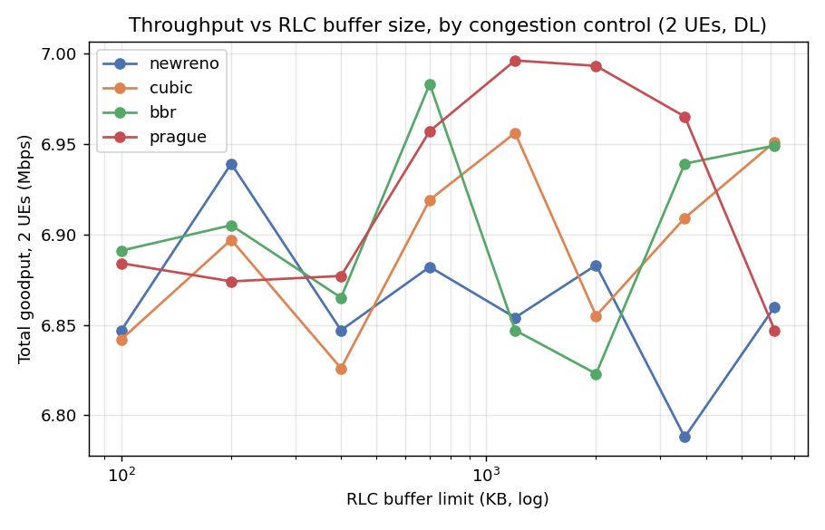

### Latency vs buffer size
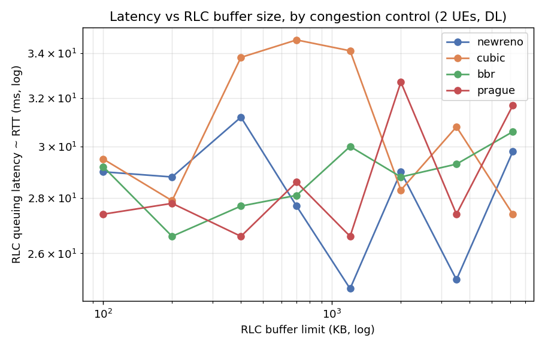

### Latency–throughput tradeoff
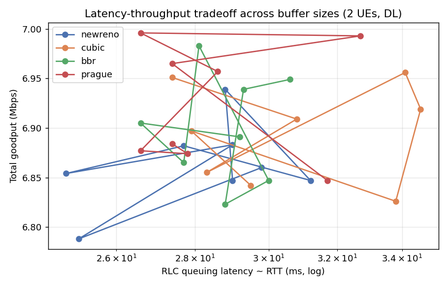

| CC | goodput (Mbps, 2 UEs) | RLC latency (ms) |
|----|----|----|
| newreno | 6.79 – 6.94 | 25 – 31 |
| cubic   | 6.83 – 6.96 | 27 – 35 |
| bbr     | 6.82 – 6.98 | 27 – 31 |
| prague  | 6.85 – 7.00 | 27 – 33 |

Per-UE split is fair (~3.5 / 3.3 Mbps, e.g. bbr @6 MB = 3.57 / 3.38).

## Key finding: the buffer limit never binds at these sizes

Across **all 4 CCs and all 8 buffer sizes**, goodput is flat at **~6.9 Mbps** and latency
is flat at **~29 ms**. There is **no bufferbloat curve and no throughput/latency tradeoff** —
the four CCs are statistically indistinguishable here.

The reason is measured directly from `upt_rlc_buffer_bytes`: over the entire campaign the
RLC DL queue occupancy was

| | value |
|----|----|
| mean | **12.8 KB** |
| p95  | **25 KB** |
| max  | **40 KB** |

The queue **peaked at 40 KB — below the *smallest* configured limit of 100 KB**. So the
byte-limit was never the binding constraint: the bottleneck is the ZMQ air-interface grant
rate (~3.4 Mbps/UE), and at that offered load QUIC's flow control + congestion control keep
only a small standing queue (~13 KB ≈ 29 ms). Changing a limit the queue never reaches has
no effect — hence the flat curves.

**The bufferbloat knee is below 40 KB, not in the 100 KB–6 MB range we swept.**

## Implications for Run 2

1. **Sweep where the limit actually binds.** Move the sweep **down** into the
   **5–80 KB** range (e.g. 5, 10, 20, 40, 60, 80, 150 KB) so the limit clips the ~40 KB
   working set. That is where we expect to see cubic/newreno collapse under-provisioned
   buffers while bbr/prague hold goodput at lower latency — the real tradeoff.
2. **Measure true QUIC RTT, not the RLC proxy.** Run 2 integrates `quic_probe.py`, which
   reads picoquic's own **qlog** (`smoothed_rtt`, `min_rtt`, `cwnd`, `bytes_in_flight`,
   loss) — the transport's actual congestion state, which is what distinguishes the CCs.

## Reproduce (Run 1)

```bash
# Run the campaign (writes cc_manifest.json):
CC_LIST=newreno,cubic,bbr,prague CYCLE_S=1140 python3 telemetry/cc_campaign.py
# Plot + table from VictoriaMetrics:
python3 telemetry/plot_campaign.py     # -> plots/*.png, campaign_results.json
```

---

## Run 2

Small **binding** buffers `[5, 10, 20, 40, 60, 80, 150, 400] KB`, same 4 CCs, ~76 min.
Latency is now the **transport's own** QUIC RTT (plus cwnd / in-flight / loss) read
from picoquic's qlog by [`quic_probe.py`](quic_probe.py) — not the RLC proxy. The
`rlc_ctrl` codelet was rebuilt with these sizes and reloaded; the xApp's `SWEEP_SCHED`
matches. Scripts: [`cc_campaign2.py`](cc_campaign2.py), [`plot_campaign2.py`](plot_campaign2.py).

### Throughput vs buffer size
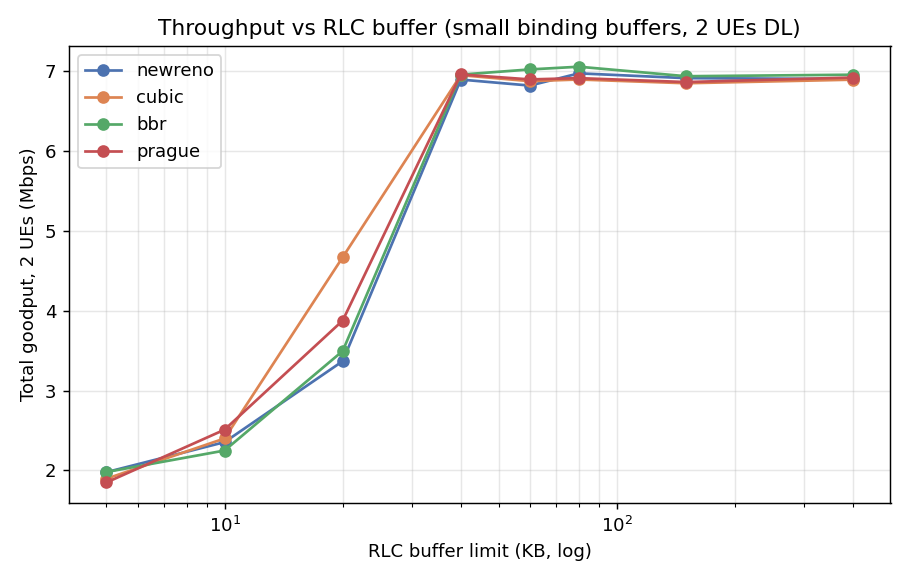

### QUIC RTT vs buffer size (endpoint smoothed RTT)
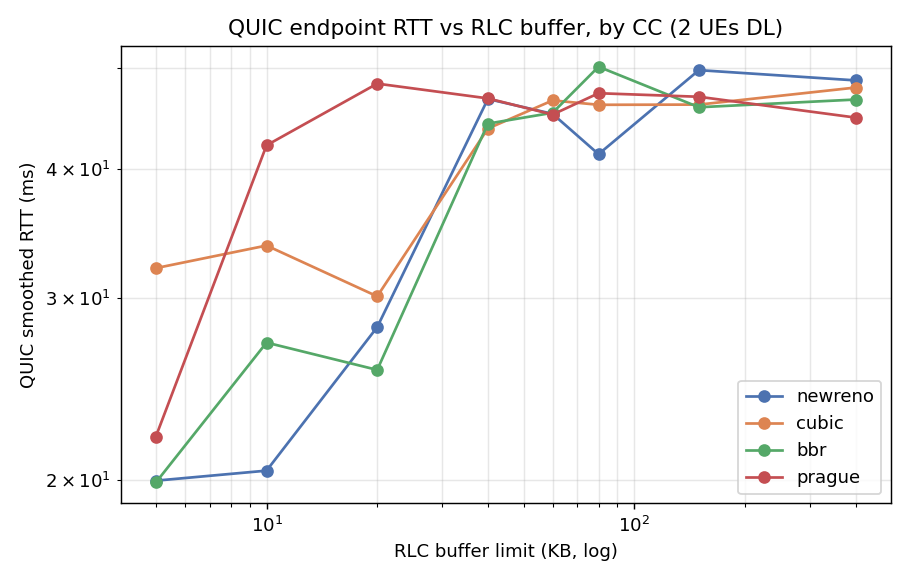

### Congestion window vs buffer size
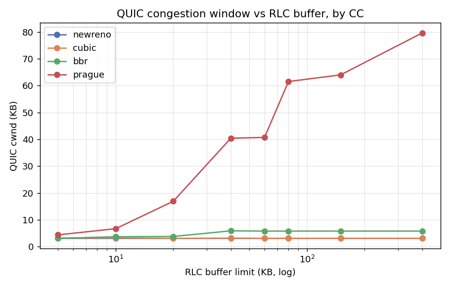

### Loss vs buffer size
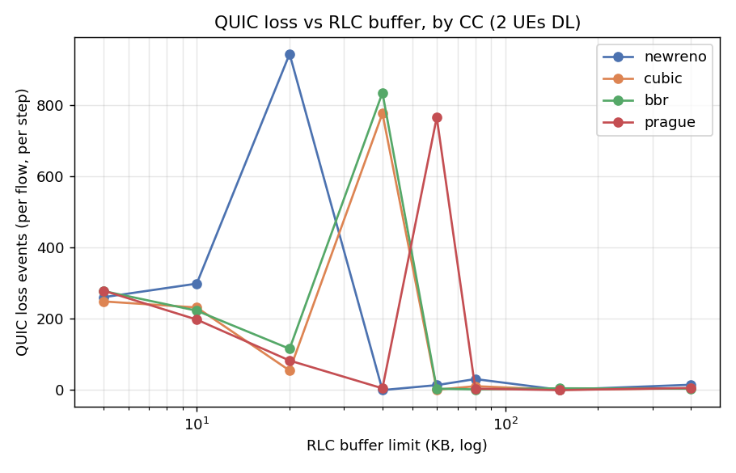

### QUIC latency–throughput tradeoff
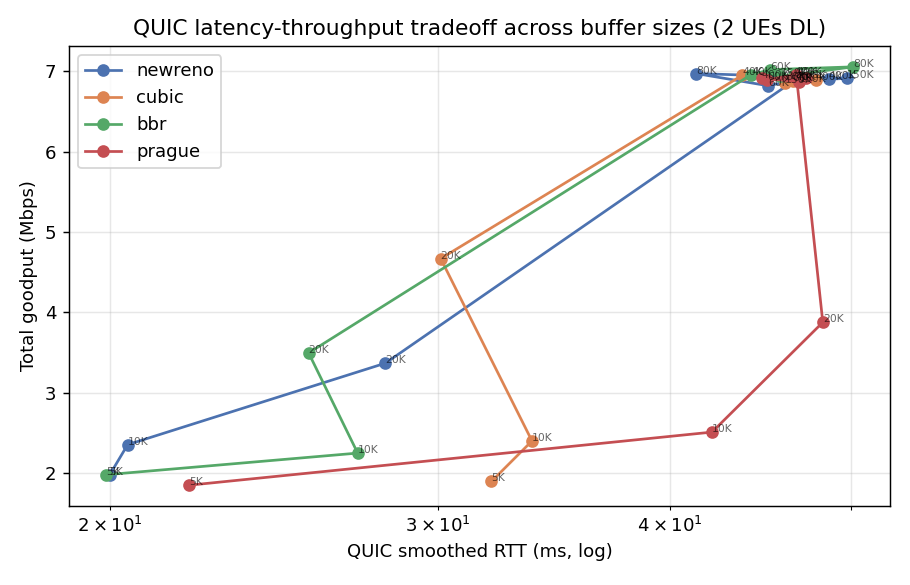

### Results (total goodput, QUIC RTT, cwnd, RLC occupancy, loss)

| CC | buf | goodput | sRTT | minRTT | cwnd | RLC occ | loss |
|----|----|----|----|----|----|----|----|
| newreno | 5 KB | 1.98 | 20.0 | 12.1 | 3.1 KB | 3.0 KB | 261 |
| newreno | 20 KB | 3.37 | 28.1 | 11.7 | 3.1 KB | 7.4 KB | 944 |
| newreno | 40 KB | 6.89 | 46.7 | 12.6 | 3.1 KB | 16.2 KB | 0 |
| newreno | 400 KB | 6.90 | 48.7 | 12.6 | 3.1 KB | 16.6 KB | 15 |
| cubic | 5 KB | 1.90 | 32.1 | 12.3 | 3.2 KB | 3.0 KB | 249 |
| cubic | 40 KB | 6.95 | 43.7 | 13.6 | 3.2 KB | 14.3 KB | — |
| cubic | 400 KB | 6.89 | 47.9 | 12.5 | 3.1 KB | 15.9 KB | 5 |
| bbr | 5 KB | 1.98 | 19.9 | 11.9 | 3.1 KB | 3.1 KB | 278 |
| bbr | 40 KB | 6.96 | 44.2 | 12.2 | 5.9 KB | 15.5 KB | — |
| bbr | 400 KB | 6.96 | 46.6 | 12.7 | 5.8 KB | 16.3 KB | 4 |
| prague | 5 KB | 1.85 | 22.1 | 12.0 | 4.4 KB | 3.1 KB | 279 |
| prague | 20 KB | 3.88 | 48.3 | 11.2 | 16.9 KB | 6.6 KB | 83 |
| prague | 400 KB | 6.92 | 44.8 | 13.1 | **79.6 KB** | 13.9 KB | 6 |

(goodput Mbps, RTTs ms. Full 8×4 table in `campaign2_results.json`.)

### Findings

1. **There is a clear knee at ~40 KB.** Below it the RLC limit clips below the
   path's bandwidth-delay product (BDP ≈ 3.4 Mbps × 12 ms ≈ 5 KB/UE) and throughput
   **collapses**: total goodput falls from ~6.9 Mbps to ~2 Mbps at 5 KB, with heavy
   loss (250–300 events/step). At ≥40 KB the pipe stays full at ~6.9 Mbps. This is
   the under-buffering regime Run 1's 100 KB floor sat entirely above.
2. **The bufferbloat tradeoff is now visible.** Small buffers = low latency but low
   throughput; large buffers = full throughput at a higher standing-queue latency
   (QUIC sRTT ~45 ms / RLC occupancy ~15 KB at ≥40 KB vs ~20 ms / 3 KB at 5 KB).
   min RTT stays ~12 ms (the base path RTT) throughout — the extra sRTT is queuing.
   The knee (~40 KB) is the sweet spot: full goodput just before latency climbs.
3. **cwnd separates the CCs — this is what Run 1 couldn't show.** newreno and cubic
   hold a tiny ~3 KB cwnd (they sit right at the BDP and never grow), bbr paces at
   ~6 KB, while **Prague fills the buffer** — its cwnd grows 4 KB → 80 KB as the
   limit rises, tracking the available buffer rather than the BDP.
4. **QUIC endpoint RTT validates the RLC proxy.** The transport's own RTT tracks the
   RLC queuing latency, confirming Run 1's proxy while adding cwnd/loss the RAN side
   can't see.

_Caveats: loss cells at the exact knee (e.g. cubic 40 KB, bbr 40 KB, prague 60 KB)
are inflated by setpoint-transition ramps and occasional qlog reconnects (visible as
n > 108); read them as "the transition is lossy", not a per-size rate. Marked "—"._

## Reproduce (Run 2)

```bash
# rlc_ctrl.cpp sweep_limit() must already hold the small sizes + codelet reloaded
# (see EXPERIMENT_LOG.md §2). Then:
CC_LIST=newreno,cubic,bbr,prague CYCLE_S=1140 python3 telemetry/cc_campaign2.py
python3 telemetry/plot_campaign2.py    # -> plots2/*.png, campaign2_results.json
```

---

## Run 3 — single-UE dynamic buffer control (DL, MCS uncapped)

Different question: apply the RLC DL buffer sweep to **one UE only** and leave the
other uncontrolled, to see the per-UE effect *and* the cross-UE coupling. The
`rlc_ctrl` codelet was modified to sweep the byte-limit for **du_ue_index 0 (ue1)**
only; **ue2 keeps srsRAN's default** (`new_byte_limit=0`). Both UEs run a bbr QUIC
download; DL MCS is **uncapped** (~47 Mbps cell). Sweep `[10,20,40,80,160,320,640,1280] KB`,
2 cycles. Scripts: [`cc_campaign3.py`](cc_campaign3.py), [`plot_campaign3.py`](plot_campaign3.py).

### Per-UE goodput vs the swept buffer
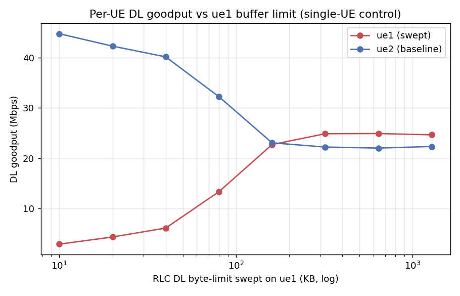

### Per-UE RLC queuing latency vs the swept buffer
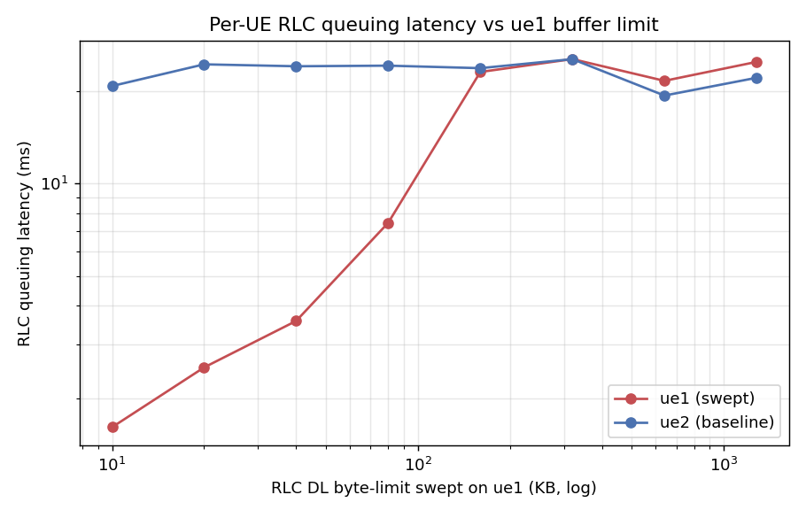

### Per-UE RLC occupancy (proof of control)
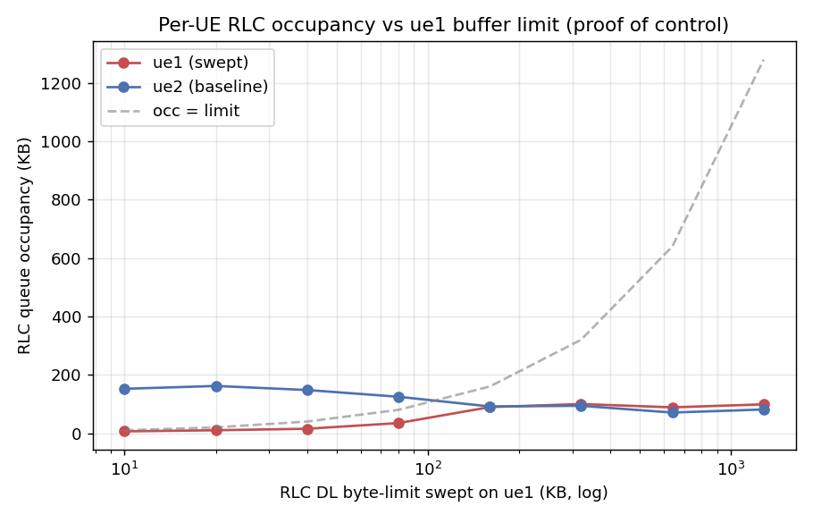

| UE | buf | goodput | QUIC sRTT | RLC lat | RLC occ |
|----|----|----|----|----|----|
| **ue1 (swept)** | 10 KB | 2.90 | 20.0 | 1.6 | 6.4 KB |
| ue1 (swept) | 40 KB | 6.10 | 21.9 | 3.6 | 15.3 KB |
| ue1 (swept) | 80 KB | 13.33 | 27.1 | 7.5 | 34.7 KB |
| ue1 (swept) | 160 KB | 22.72 | 40.4 | 23.1 | 89.5 KB |
| ue1 (swept) | 320 KB | 24.88 | 42.2 | 25.4 | 100 KB |
| ue1 (swept) | 1280 KB | 24.66 | 42.3 | 24.9 | 98.9 KB |
| **ue2 (baseline)** | (ue1=10 KB) | 44.77 | 35.3 | 20.8 | 152 KB |
| ue2 (baseline) | (ue1=80 KB) | 32.25 | 40.1 | 24.2 | 125 KB |
| ue2 (baseline) | (ue1≥160 KB) | ~22.3 | ~40 | ~22 | ~80 KB |

(goodput Mbps, RTT/lat ms. Full table in `campaign3_results.json`.)

### Findings

1. **Single-UE control works cleanly.** The swept UE's occupancy tracks its limit
   (6→35 KB for 10→80 KB limits) and its goodput climbs monotonically **2.9 → 24.9 Mbps**
   as the limit grows, saturating at ~25 Mbps (its fair half of the cell) by ~320 KB.
   ue2's queue is untouched (occupancy ~80–160 KB regardless), confirming the control
   is truly per-UE.
2. **Bufferbloat tradeoff on the controlled UE.** Small buffer = low latency, low
   throughput (10 KB: 2.9 Mbps @ **1.6 ms** RLC); large buffer = full throughput at a
   standing-queue cost (≥160 KB: ~25 Mbps @ **~24 ms**). The knee is ~80–160 KB
   (80 KB gives 13 Mbps at 7.5 ms — the best latency/throughput compromise).
3. **Cross-UE coupling — the headline.** The two UEs' goodput sums to ~47 Mbps (the cell
   capacity) at every point, so **starving one UE hands its bandwidth to the other**:
   at ue1=10 KB, ue2 jumps to **44.8 Mbps**; the curves **cross at ~160 KB** where both
   sit at their ~23 Mbps fair share. So a per-UE buffer limit acts as a coarse **DL rate/
   fairness knob** on a shared cell, not just a per-UE latency control.
4. **ue2 latency is flat (~20–25 ms)** across the whole sweep — its buffer never changes;
   only its *rate* moves (via the shared scheduler), not its queuing delay.

## Reproduce (Run 3)

```bash
# rlc_ctrl.cpp: sweep gated on du_ue_index==SWEEP_TARGET_UE (0); rebuilt + reloaded.
# DL MCS uncapped. Then:
CC_LIST=bbr CYCLE_S=2250 python3 telemetry/cc_campaign3.py
python3 telemetry/plot_campaign3.py    # -> plots3/*.png, campaign3_results.json
```
